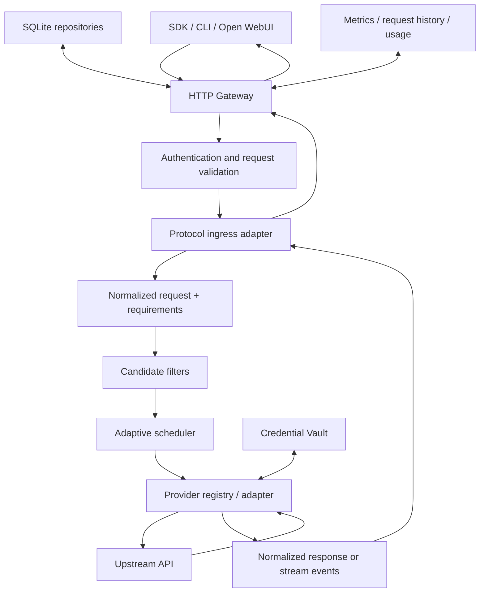

# OmniRouter architecture and engineering conventions

Status: current implementation guide for dev. Last reconciled: 2026-11-08.
Branch policy: main is stable; integration work lands in dev first.

This document describes the architecture that exists today, the boundaries new
work must preserve, and the acceptance evidence required before a capability is
advertised. It is protocol- and evidence-oriented, not an aspirational feature list.

## 1. Design goals

1. One small Go gateway process; no mandatory microservices, Redis, Python, or Node.js at runtime.
2. Protocol ingress is independent from upstream Provider implementations.
3. Every Provider declares the protocol interfaces and model capabilities it can actually serve.
4. Selection is deterministic and explainable: filter first, score second.
5. Credentials are centrally encrypted and never returned by admin read APIs.
6. Streaming is a lifecycle: completion, cancellation, premature EOF, and upstream failure remain distinguishable.
7. Compilation is not completion. Deterministic CI, live-provider acceptance, and device acceptance are separate evidence tiers.

## 2. High-level architecture

The gateway owns public HTTP contracts, authentication, request limits,
capability extraction, protocol conversion, stream lifecycle, usage capture,
and sanitized request metadata. Provider adapters own upstream URL/auth
construction, provider-specific payloads, response parsing, and upstream SSE
semantics. The scheduler does not parse provider payloads.

## 3. Request lifecycle

1. **Ingress and authentication** — route and method are matched; gateway API authentication is checked; request size and JSON shape are validated.
2. **Protocol classification** — ingress determines the requested operation (Chat Completions, Responses, Anthropic Messages, or Gemini generation) and required capabilities.
3. **Request profile** — the gateway derives objective and estimated token requirements. Optional X-OmniRouter-Objective, X-OmniRouter-Input-Tokens, and X-OmniRouter-Output-Tokens are gateway controls, not upstream protocol fields.
4. **Candidate resolution** — providers are considered only if they expose the required operation, contain the requested model, and declare all required capabilities.
5. **Candidate filtering** — disabled providers, unhealthy/cooling providers, unsupported protocol interfaces, missing models, and missing capabilities are excluded. Filters only remove candidates.
6. **Selection** — the adaptive scheduler scores remaining candidates using objective-specific estimated cost, observed latency, reliability, operator priority, and configured weight. Missing price is unknown, not zero/free.
7. **Upstream execution** — the selected Provider maps the normalized request to its native wire protocol. The gateway records outcome and latency.
8. **Response normalization / relay** — non-streaming results are validated before writing. Streaming events are relayed while tracking usage and an explicit protocol terminal condition.
9. **Accounting and observability** — request ID, selected Provider/model, status, duration, usage, and sanitized error classification are recorded. Secrets and full prompt bodies are not observability fields.

### Retry and failover rules

- A non-streaming attempt may fail over to another eligible Provider while preserving model and capability requirements.
- A candidate must not be attempted twice within the same bounded attempt sequence.
- Provider failure feedback updates health/cooldown and adaptive reliability.
- Once a streaming response is committed to the client, do not silently retry on another Provider: already delivered tokens cannot be rolled back, and retrying can duplicate output.
- A stream is successful only when the adapter recognizes the protocol's explicit terminal event and downstream writing completes. EOF alone is not proof of completion.
- Downstream cancellation must cancel the upstream request through the request context and must not be counted as success.

## 4. Protocol ingress and Provider egress are different axes

Do not conflate an inbound protocol endpoint with a native upstream adapter.

| Ingress / egress | Current implementation |
|---|---|
| OpenAI Chat Completions ingress | Implemented |
| OpenAI Responses ingress | Implemented |
| Anthropic Messages ingress | Implemented |
| Gemini generate / streamGenerate ingress | Implemented for documented subset |
| Generic OpenAI-compatible egress | Implemented |
| DeepSeek official API egress | Implemented |
| Native OpenAI Responses egress | Implemented |
| Native Anthropic Messages egress | Implemented |
| Native Gemini egress | Implemented |
| DeepSeek consumer-web session egress | Not merged / not inference-capable |

The same public ingress may be served by different egress adapters only when
the selected Provider explicitly implements the corresponding interface. A
generic OpenAI-compatible Provider must not be treated as native Responses,
Anthropic, or Gemini merely because it can accept a Chat Completions translation.

## 5. Provider adapter contract

New adapters belong under internal/provider/<provider> and are registered
through internal/adapter/factory.go. Keep the public Provider interface small;
add optional capability interfaces for protocol-specific operations.

A Provider implementation should:

- validate and normalize configuration at construction time;
- expose stable Provider ID, name, model catalogue, and declared capabilities;
- build URLs from a fixed/validated origin and known endpoint paths;
- apply authentication only to the intended upstream host;
- use request contexts and bounded connect/TLS/header timeouts;
- bound response bodies, SSE line/frame sizes, and parser memory;
- preserve meaningful provider metadata without leaking secrets;
- classify authentication, rate-limit, policy, timeout, transport, malformed-response, and incomplete-stream errors;
- expose an explicit terminal condition for each streaming protocol;
- return typed unsupported-operation errors rather than guessing conversions;
- include unit tests for payloads, headers, error mapping, and stream endings.

Avoid provider-specific conditionals in the generic scheduler. The adapter
factory selects implementations by persisted Provider kind; the scheduler
works with common model metadata and optional protocol interfaces.

### Capability declaration

Capabilities are positive declarations, not optimistic defaults. Distinguish
text, vision, tools, streaming, JSON output, and protocol-specific operations.
A capability may come from operator configuration or verified provider
metadata, but its source should be visible. Do not infer native tool support
from a model name or from a text-only success test.

## 6. Adaptive scheduler

The scheduler is a two-stage pipeline.

**Stage A — eligibility**
- Provider enabled and account/credential state permits use.
- Provider is not in active cooldown.
- Requested model is present for this Provider.
- Required protocol interface exists.
- Every required capability is declared.

**Stage B — ranking**
- Apply objective-specific weights for cost, latency, reliability, priority, and configured weight.
- Use observed outcomes as feedback; keep cold-start priors explicit.
- Treat missing price as unknown. Never silently interpret missing price as free.
- Use estimates only for routing. They are not billing-grade token counts.

The current request objective and pricing controls are documented in
[ADAPTIVE-SCHEDULER.md](ADAPTIVE-SCHEDULER.md). Keep scoring deterministic
for the same input/state so tests and incident reports can reproduce a choice.

## 7. Credentials, accounts, and sessions

- Provider metadata stores references and non-secret configuration only.
- API keys, access tokens, refresh tokens, and cookies belong in the encrypted Credential Vault, not Provider JSON or logs.
- SQLite stores ciphertext and metadata; the deployment supplies and backs up the encryption key separately.
- Admin list/get responses expose metadata only. Secret reveal is an internal execution operation, never a public read API.
- Account identity, credential lifecycle, and session lifecycle are distinct records. Revocation must invalidate the credential path, not merely hide a UI row.
- Logs, metrics labels, traces, errors, and request history must redact Authorization, Cookie, Set-Cookie, bearer tokens, pairing nonces, and provider-specific session identifiers.

### DeepSeek consumer-web is a separate trust domain

The consumer website is not the official API. Its browser session, private
protocol, model catalogue, rate limits, and policy responses must not share
assumptions with kind: deepseek.

The current DeepSeek Web work is a Draft-only pairing/session scaffold. It is
not part of the merged dev provider registry and does not provide inference.
If continued, implement it in independently reviewable stages:

1. **Authorization** — user signs in normally; a narrow browser extension reads only the active chat.deepseek.com tab after an explicit click; one-time pairing is loopback-only, origin-allowlisted, short-lived, and single-use.
2. **Credential lifecycle** — validate and encrypt only the minimum accepted token/cookie material; support expiry, revoke, replace, and status checks.
3. **Protocol evidence** — collect sanitized, user-authorized request/response fixtures. Do not guess private endpoint fields or treat community notes as a stable contract.
4. **Transport** — implement a versioned transport only from verified fixtures. Do not automate password/MFA/CAPTCHA, solve challenges, bypass WAF, rotate identities, or retry around rate limits. On policy challenge or rejection, stop and require the user to complete the ordinary browser flow.
5. **SSE normalization** — parse bounded frames, map only known event types, preserve reasoning separately, require a recognized terminal event, and propagate cancellation.
6. **Conversation lineage** — persist the mapping between local conversation IDs and upstream session/parent-message IDs; isolate by account; reject cross-account or stale lineage.
7. **Model/capability publication** — do not advertise a model or capability until request, response, streaming, continuation, and failure behavior have fixture and authorized live acceptance coverage.

A successful browser pairing proves authorization material was imported. It
does not prove the private inference protocol works.

## 8. Error and stream contract

| Class | Typical handling |
|---|---|
| Invalid client request | 400; do not penalize Provider |
| Gateway authentication failure | 401/403; do not penalize Provider |
| No eligible Provider | 503; record requirements and reason |
| Upstream authentication / policy rejection | classify separately; do not challenge-bypass |
| Upstream rate limit | bounded retry only where safe; apply cooldown/backoff |
| Upstream timeout / transport failure | report failure and allow safe non-stream failover |
| Malformed upstream payload | provider protocol error; report failure |
| Stream missing terminal event | incomplete stream; never mark success |
| Downstream cancellation | cancelled/interrupted; cancel upstream |

Do not return raw upstream error bodies if they may contain tokens, cookies,
internal URLs, or account data. Client-facing messages should be stable and
sanitized; detailed diagnostics should be structured and redacted.

## 9. Test and acceptance pyramid

| Layer | Purpose | Evidence |
|---|---|---|
| Unit | Adapter mapping, validation, parser limits, error classification | Go unit tests |
| Contract fixtures | Known provider request/response/SSE shapes | Sanitized checked-in fixtures |
| Integration | Gateway + adapter + SQLite + scheduler | httptest and real SQLite tests |
| Static / race | Format, vet, race, shell/YAML and frontend checks | GitHub Actions |
| Cross-build | Target OS/architecture build and package | CI matrix |
| Live provider | Credentials, actual upstream semantics, rate-limit/error behavior | Manual secret-backed smoke report |
| Device | Termux process, SQLite, storage, LAN, lifecycle | Real-device acceptance record |

A green CI matrix proves deterministic repository checks and cross-builds. It
does not prove provider credentials, live upstream compatibility, browser
session acceptance, production restore, or Android/Termux device behavior.

## 10. Documentation conventions

Every feature guide should use the same structure:

1. Status and scope (implemented / partial / draft / unsupported).
2. Supported endpoints and exact protocol subset.
3. Configuration and secret handling.
4. Request/response behavior, including stream terminal semantics.
5. Failure behavior and known limitations.
6. Unit/fixture/integration evidence.
7. Live acceptance procedure and what it does not prove.
8. Explicit non-goals.

Keep README concise: current capability matrix, quick start, links to detailed
guides, and current release status. Put design decisions and protocol details
in focused documents. Keep historical implementation notes labelled
historical so they cannot override current status.

## 11. Reference projects and adopted lessons

These are design references, not code to copy wholesale:

- [LiteLLM routing](https://docs.litellm.ai/docs/routing) and
  [deployment selection](https://docs.litellm.ai/docs/router/learn/selection):
  separate candidate filters from ranking; distinguish retry within a model
  group from fallback; make routing objectives explicit; treat price and
  reliability as measurable inputs.
- [Open WebUI OpenAI-compatible integration](https://docs.openwebui.com/getting-started/quick-start/connect-a-provider/starting-with-openai-compatible/):
  prefer stable protocol contracts; document model discovery separately from
  connection verification; let operators explicitly disable a connection;
  avoid proprietary provider branches in a generic protocol path.

OmniRouter keeps its own Go modular-monolith and SQLite-first design. The
references inform boundaries and documentation discipline, not a mandate to
adopt their runtime stacks or configuration models.
